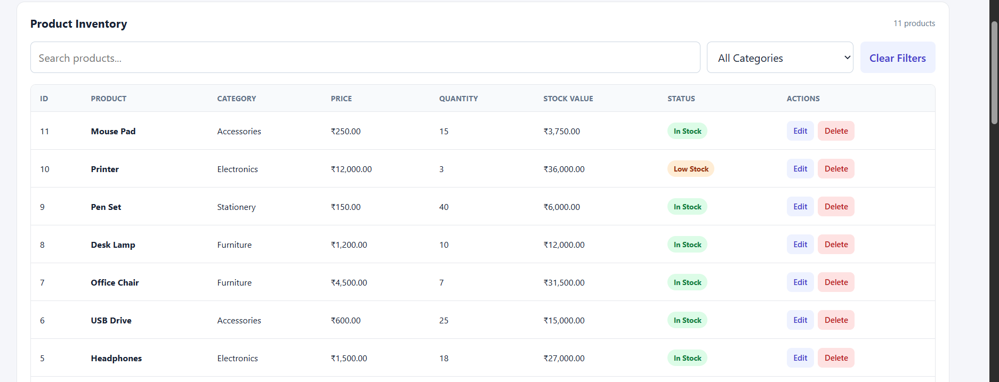
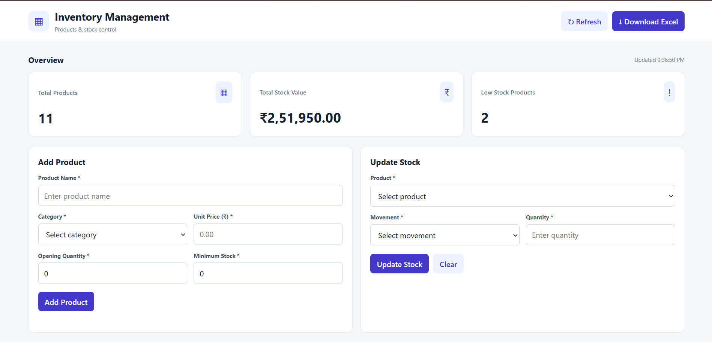

# Inventory & Stock Management System

A web-based inventory management application built using Python, Flask, and MySQL. It helps users manage products, monitor stock levels, record stock movements, and export inventory reports to Excel.

## Features

- **Dashboard:** View total products, total stock value, and low-stock products.
- **Product Management:** Add, edit, search, filter, and delete products.
- **Category Management:** Organize products into Electronics, Accessories, Furniture, Stationery, and Other.
- **Stock Management:** Record Stock In and Stock Out transactions.
- **Stock Validation:** Prevent stock-out quantities from exceeding available stock.
- **Transaction History:** Review recent inventory movements.
- **Excel Export:** Download inventory data and category-wise stock value summaries.
- **MySQL Database:** Store product details and stock transactions.
- **Power BI:** Inventory analytics and reporting through the included Power BI report.

## Technology Stack

| Technology | Purpose |
|---|---|
| Python | Backend programming |
| Flask | Web application and API |
| MySQL | Database |
| HTML, CSS, JavaScript | Frontend |
| Pandas and OpenPyXL | Excel report generation |
| Power BI | Data visualization and analytics |

## Screenshots

### Dashboard and Inventory


### Stock Management and Transactions



### Product Management



### Power BI Dashboard


## Project Structure

```text
Inventory-Stock-Management-System/
├── app.py
├── templates/
│   └── index.html
├── database/
│   ├── schema.sql
│   └── sample_data.sql
├── Screenshots/
│   ├── dashboard.png
│   └── stock-management.png
├── Inventory.pbix
├── .gitignore
└── README.md
```

The database SQL files are included in the structure above only if they exist in the repository.

## Installation and Setup

### 1. Clone the repository

```bash
git clone https://github.com/Divek-N/Inventory-Stock-Management-System.git
cd Inventory-Stock-Management-System
```

### 2. Create and activate a virtual environment

```bash
python -m venv venv
```

Windows PowerShell:

```powershell
.\venv\Scripts\Activate.ps1
```

### 3. Install dependencies

```bash
python -m pip install Flask mysql-connector-python pandas openpyxl python-dotenv
```

### 4. Configure the database

Create the MySQL database and required tables according to the application's database schema.

Create a local `.env` file in the project root:

```dotenv
DB_HOST=localhost
DB_PORT=3306
DB_USER=root
DB_PASSWORD=your_mysql_password
DB_NAME=inventory_db
```

Replace `your_mysql_password` with your own local MySQL password. Never commit this file to GitHub.

### 5. Start the application

```bash
python app.py
```

Open the following URL in your browser:

http://127.0.0.1:5000/

## Excel Reports

The application exports an Excel workbook containing:

- **Inventory:** Product details, prices, quantities, minimum stock, stock value, and stock status.
- **Category Summary:** Category-wise stock value.

## Future Improvements

- User authentication and role-based access.
- Supplier and purchase-order management.
- Advanced inventory analytics.
- Automated low-stock notifications.

## Author

**Divek N.**

GitHub: [Divek-N](https://github.com/Divek-N)

## License

This project is available for educational and portfolio purposes. Add a license file if you intend to distribute it under specific reuse terms.
